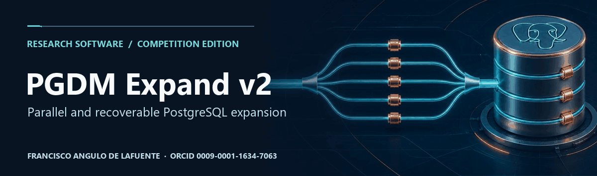
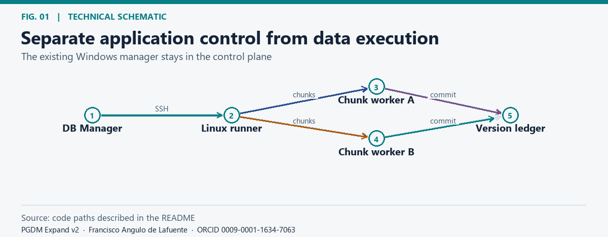
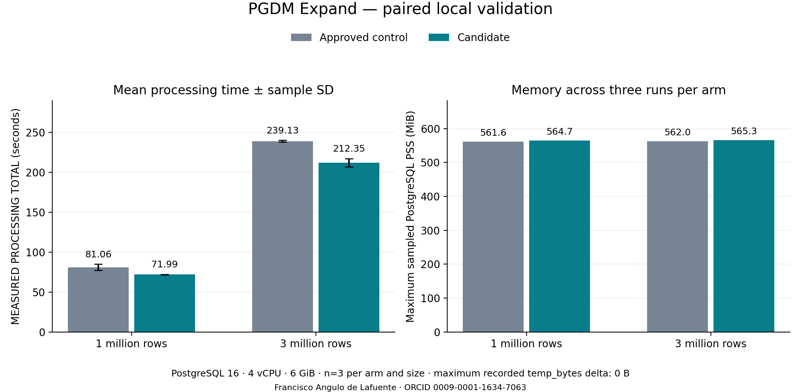
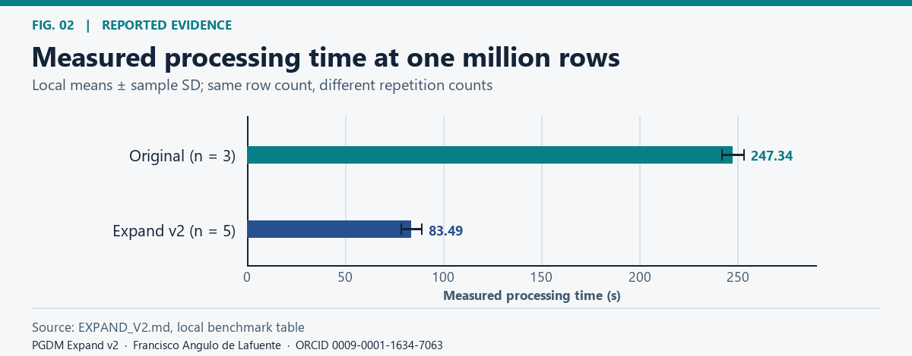
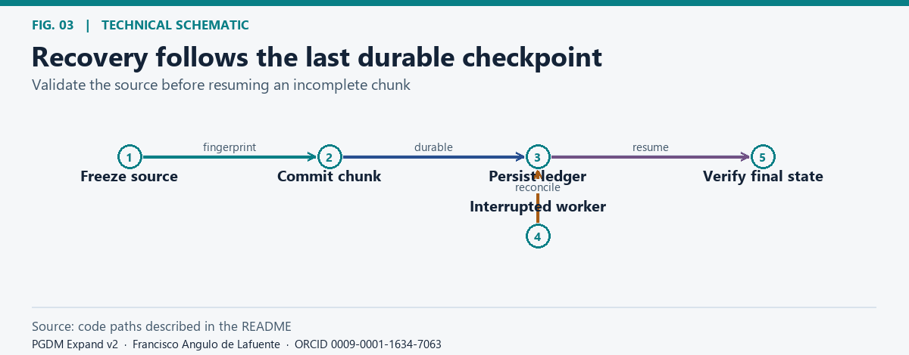
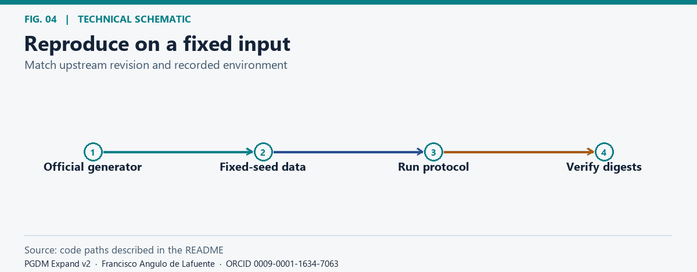
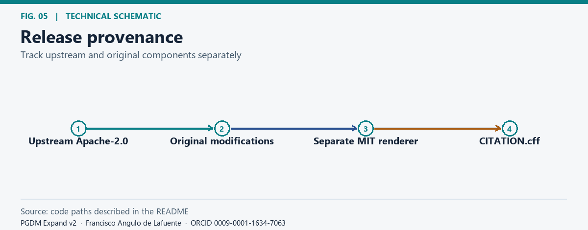

# PGDM Expand v2

**Copyright © 2026 Francisco Angulo de Lafuente for original contributions and modifications only. Attribution record: 2026-11-06.**

**Research author:** [Francisco Angulo de Lafuente](https://orcid.org/0009-0001-1634-7063) for the original PGDM Expand v2 contributions · [Citation](CITATION.cff).

<!-- impact-note:start -->
<strong>Efficiency and practical value.</strong> Building on the credited upstream PostgreSQL engine, JSON-path fusion and a guarded Expand rewrite reduce repeated processing work. The repository reports 11.2% lower mean runtime than the approved control at both one and three million source rows on the same four-vCPU setup, with output checks preserved. This measured speed benefit does not by itself quantify electricity savings. See the <a href="VALIDATION_20261108.md">paired validation</a>.
<!-- impact-note:end -->

## Research scope

*Separate application control from data execution.* [Static figure](docs/figures/architecture.png).

An engineering implementation for the [November Python & PostgreSQL Data Pipeline Optimization Challenge](https://www.kaggle.com/competitions/python-postgre-sql-data-pipeline-optimization-challenge). This project focuses on redesigning execution of the cross-table Expand operation and is distinct from the earlier QueryFoundry write-up. It builds on [Igor Moreira’s Apache-2.0 project](https://github.com/igorsiecz/kaggle_postgre_challenge/tree/5dfde9d967425982229b92d6ffe98efcd74612e9). A Git-blob comparison confirms that the database generator, six official SQL recipes, and their setup guide match that upstream revision. The research implementation adds new files and modifies three upstream files; see [NOTICE](NOTICE) and [LICENSE_SCOPE.md](LICENSE_SCOPE.md) for the exact boundaries. No official Kaggle submission or score is claimed for this repository.

## Latest paired validation — 8 November 2026

The final compiler combines constant JSON path fusion with a guarded rewrite of homogeneous lateral VALUES into UNION ALL SELECT branches. It retains the official generator, seed and six recipe files, all six foreign keys, validation, row counters and version/dependency registration. The code measured below is `c95d7a1e0851f31773f61c2fc2e94147d99c27c2`; the control is the previously approved public engine `b16f593c3eece730a868e5d1e490bd0f2ab8e06d`.

| Source rows | Control seconds, mean ± sample SD | Final candidate seconds, mean ± sample SD | Less mean processing time |
|---|---:|---:|---:|
| 1,000,000 | 81.06 ± 3.91 | 71.99 ± 0.42 | 11.2% |
| 3,000,000 | 239.13 ± 1.17 | 212.35 ± 5.11 | 11.2% |

Three reset/run/verify pairs per size, AB/BA/AB, on the same AMD Ryzen 7 3700X server, PostgreSQL 16.15, Docker limited to 4 vCPU and 6 GiB. All twelve runs passed content/counter/version checks; all six 3M outputs also match the archived original-engine reference. Candidate memory stays within the predefined bound and recorded `temp_bytes` deltas are zero. Small global/checkpoint relations remain. No GPU is used.

The same frozen code passes three interruption scenarios, four edge checks and a 100k full smoke on a separate workstation; 35 unit tests pass. See the [complete validation report](VALIDATION_20261108.md) for paired ratios and uncertainty, raw evidence, resource measurements, recovery, retained negative results and limits. Local results support this implementation choice; the organizers' standardized benchmark determines the competition score.

## Historical measured evidence

*Measured processing time at one million rows.* [Static figure](docs/figures/runtime.png).

On one million source rows, the original path recorded 247.34 ± 5.59 s (three runs) and v2 recorded 83.49 ± 5.24 s (five). The three-million-row v2 series recorded 258.90 ± 5.70 s (two runs). These are means and sample standard deviations from the local protocol on engine `86ca8a9`, not official scores. On a second machine the previously approved engine recorded 77.57 ± 4.18 s against 139.31 ± 10.71 s for the original (three runs each); the two machines are not comparable. Output digests matched in the reported runs. See [experiment details](EXPAND_V2.md#results).

## Recovery and integrity

*Recovery follows the last durable checkpoint.* [Static figure](docs/figures/recovery.png).

The design records completed chunks and preserves source and result checks. Recovery from an interrupted run is tested separately from timing. See [failure recovery](EXPAND_V2.md#4-failure-recovery) and [integrity guarantees](EXPAND_V2.md#3-integrity-guarantees-eligibility-gate).

## Reproduce

*Reproduce on a fixed input.* [Static figure](docs/figures/reproduce.png).

Run the unit tests with Python and the project dependencies. For paired confirmation and the historical end-to-end benchmark use the unchanged generator, the Windows Manager and a Linux PostgreSQL instance, following the [benchmark guide](benchmarks/README.md). Keep credentials and generated databases outside Git.

<!-- author-background:start -->
## Author background

**Francisco Angulo de Lafuente**, independent AI researcher · [ORCID](https://orcid.org/0009-0001-1634-7063) · [arXiv](https://arxiv.org/a/angulodelafuente_f_1.html) · [Google Scholar](https://scholar.google.com/citations?user=6nOpJ9IAAAAJ) · [ResearchGate](https://www.researchgate.net/profile/Francisco-Angulo-Lafuente-3) · [Figshare](https://figshare.com/authors/Francisco_Angulo_de_Lafuente/22601234) · [Wikipedia](https://es.wikipedia.org/wiki/Francisco_Angulo_de_Lafuente)

Earlier research at ECOFA focused on biotechnology for clean energy and on second-generation biofuels obtained by microbiological processing of organic waste. Two Spanish patents document that work:

- **ES 2273594 B1**, *Process for obtaining fuels from organic waste*. Filed 5 September 2005, grant published 16 February 2008. [OEPM](https://www.oepm.es/pdf/ES/0000/000/02/27/35/ES-2273594_B1.pdf) · [Google Patents](https://patents.google.com/patent/ES2273594B1/en)
- **ES 2341194 B1**, *Method for obtaining paraffin by a biological process with microorganisms from organic matter, and its refining for use as fuel*. Filed 11 September 2007, grant published 26 April 2011. Also published as EP2196519 and WO2009034217. [OEPM](https://www.oepm.es/pdf/ES/0000/000/02/34/11/ES-2341194_B1.pdf) · [Google Patents](https://patents.google.com/patent/ES2341194B1/en)

These are historical publication and grant records under the inventor name Francisco Angulo Lafuente, and both have since lapsed. They are cited as evidence of a research trajectory and make no statement about current enforceability.
<!-- author-background:end -->

## License and citation

*Release provenance.* [Static figure](docs/figures/rights.png).

The derivative software remains under the existing Apache-2.0 terms and retains upstream notices. The independent figure renderer at tools/render_lab_figures.py is separately designated MIT under LICENSE.figures. See LICENSE_SCOPE.md for verified and unresolved file boundaries; no new license claim is made for benchmark results, figure outputs, or the cover.

## Bibliography and proposed checks

- [PostgreSQL, Parallel Plans](https://www.postgresql.org/docs/current/parallel-plans.html). Recheck the plan on each major PostgreSQL version.
- [PostgreSQL, Transaction Isolation](https://www.postgresql.org/docs/current/transaction-iso.html). Retest recovery at transaction boundaries and under competing locks.

The [updated provenance record](provenance-20261108.json) preserves exact source/figure hashes, normalized fingerprints of the original compiler contributions, public researcher identifiers and the historical patent references. The [earlier baseline](provenance-baseline.json) remains a separate dated record.

**Attribution.** Cite [Francisco Angulo de Lafuente](https://orcid.org/0009-0001-1634-7063) using [CITATION.cff](CITATION.cff). Preserve upstream notices and consult LICENSE_SCOPE.md before reusing files outside the explicitly attributed code. The MIT notice below applies only to tools/render_lab_figures.py.

**Reuse notice for the original figure renderer file tools/render_lab_figures.py only:**

This project contains open-source material under the MIT License. When redistributing copies or substantial portions, retain the copyright and permission notices. If you build on this work, please cite the project and credit Francisco Angulo de Lafuente (ORCID: 0009-0001-1634-7063). Help advance scientific knowledge: we welcome reproducible results, corrections, and contributions.

<!-- research-provenance: project=pgdm-expand-v2; original-record=2026-11-04; creator=Francisco Angulo de Lafuente; orcid=https://orcid.org/0009-0001-1634-7063; attribution-recorded-on=2026-11-06; license-scope=LICENSE_SCOPE.md; upstream-comparison=git-blobs; upstream-base=5dfde9d967425982229b92d6ffe98efcd74612e9 -->
